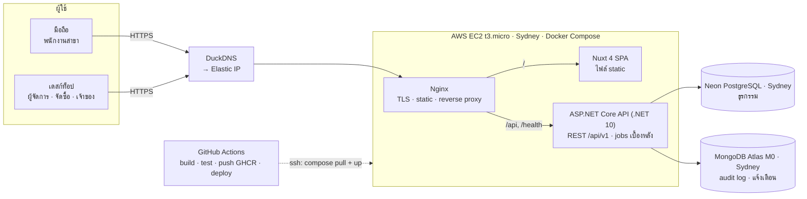

# Architecture

## ภาพรวม



## ชิ้นส่วน

| ชิ้น | เทคโนโลยี | หน้าที่ |
| --- | --- | --- |
| Frontend | Nuxt 4, Vue 3, TypeScript, Tailwind, Pinia | หน้าจอมือถือและเดสก์ท็อป · build เป็น static (ADR-0004) |
| API | ASP.NET Core (.NET 10), EF Core + Npgsql, MongoDB.Driver, FluentValidation, QuestPDF | REST, กฎธุรกิจ, สิทธิ์, PDF |
| Jobs | `BackgroundService` ใน process เดียวกับ API | แจ้งเตือนใกล้หมดอายุ 07:00 · ยกเลิกยอดค้างส่งรายวัน |
| PostgreSQL | Neon (free) | ข้อมูลธุรกรรมทั้งหมด (ADR-0001) |
| MongoDB | Atlas M0 (free) | audit log, notification |
| Reverse proxy | Nginx + Let's Encrypt (certbot) | TLS, gzip, cache ไฟล์ static, ส่งต่อ `/api` |

## โครง backend (ADR-0002)

```
apps/api/
├─ StockFlow.Api/
│  ├─ Program.cs                 DI, auth, ProblemDetails, health checks, Swagger
│  ├─ Common/                    Result, errors, clock (Asia/Bangkok), current user
│  ├─ Domain/                    entity + กฎธุรกิจล้วน ไม่แตะ EF (PurchaseOrder.Approve() ฯลฯ)
│  ├─ Features/
│  │  ├─ Auth/                   DemoLogin, Me
│  │  ├─ PurchaseOrders/         Submit, Approve, Reject, Consolidate, Pdf, MarkSent
│  │  ├─ GoodsReceipts/          Create, ReceivablePos
│  │  ├─ PurchaseRequests/
│  │  ├─ Stock/                  Expiring, Adjust
│  │  ├─ Products/
│  │  └─ Notifications/
│  ├─ Infrastructure/
│  │  ├─ Persistence/            AppDbContext, configurations, migrations
│  │  ├─ Mongo/                  AuditLogWriter, NotificationStore
│  │  └─ Jobs/                   ExpiryAlertJob, OutstandingCancelJob
│  └─ Seed/                      DemoSeeder
└─ StockFlow.Tests/
   ├─ Unit/                      Domain (ขอบ 5,000 / 5,001, แปลงหน่วย ฯลฯ)
   └─ Integration/               WebApplicationFactory + Testcontainers (Postgres, Mongo)
```

1 ฟีเจอร์ = 1 โฟลเดอร์ มี endpoint, request/response, validator และ handler อยู่ด้วยกัน ตามชื่อ US

## ข้อกำหนดที่ไม่ใช่ฟังก์ชัน

| เรื่อง | ค่า |
| --- | --- |
| เวลา | เก็บ `timestamptz` เป็น UTC · วันหมดอายุเป็น `date` · "วันนี้" คำนวณตามเวลา Asia/Bangkok |
| Error | RFC 9457 ProblemDetails ทุก endpoint (ดู api-spec) |
| Concurrency | PO และ stock lot ใช้ optimistic concurrency (`xmin` ของ PostgreSQL) ชนกันได้ 409 |
| กดซ้ำ | `POST /goods-receipts` รองรับ `Idempotency-Key` (US-001 AC 9) |
| Health | `/health/live` เช็กแค่ process · `/health/ready` เช็ก Postgres + Mongo (timeout 5 วิ เผื่อ Neon ตื่นจาก suspend) |
| Log | Serilog เขียน JSON ออก stdout · มี `traceId` ทุก request และส่งกลับใน ProblemDetails |
| ความปลอดภัย | HTTPS อย่างเดียว · cookie `HttpOnly; Secure; SameSite=Lax` · secret อยู่ใน `.env` บน VM และ GitHub Secrets เท่านั้น |
| เป้าหมายเวลา | API ตอบ p95 < 300 ms (ไม่นับ cold start ของ Neon) |

## Deploy

| ขั้น | ทำอะไร |
| --- | --- |
| PR | `ci.yml`: build + unit + integration (Testcontainers) + typecheck + compose smoke test |
| merge เข้า main | CI ผ่าน → `cd.yml` build image `api`, `migrator` (EF bundle), `web` → push GHCR แท็ก `sha-<7 ตัว>` |
| deploy | ssh เข้า VM → `deploy/scripts/deploy.sh`: pull → รัน migration bundle → `docker compose up -d` → เช็ก `/health/ready` ถ้าไม่ผ่าน rollback เป็น image tag ก่อนหน้า |

**ข้อจำกัดของ t3.micro (RAM 1 GB):** ไม่รัน DB บน VM · build image บน GitHub Actions เท่านั้น · เพิ่ม swap 2 GB · จำกัด memory ของ container API ที่ 400 MB · ไม่มีอะไร poll `/health/ready` ตลอดเวลา เพื่อให้ Neon หลับได้

**Region:** ทุกชิ้นอยู่ `ap-southeast-2` (Sydney) เพราะ AWS Free Plan ใช้ได้ region เดียว (ADR-0006) · ขั้นตอนตั้งค่า VM อยู่ใน [deploy/README.md](../../deploy/README.md)

## ประวัติการแก้ไข

| วันที่ | การเปลี่ยนแปลง |
| --- | --- |
| 17 พ.ย. 2026 | ฉบับแรก |
| 20 พ.ย. 2026 | ย้าย hosting จาก GCE (us-west1) ไป AWS EC2 Sydney พร้อม Neon และ Atlas (ADR-0006) |
