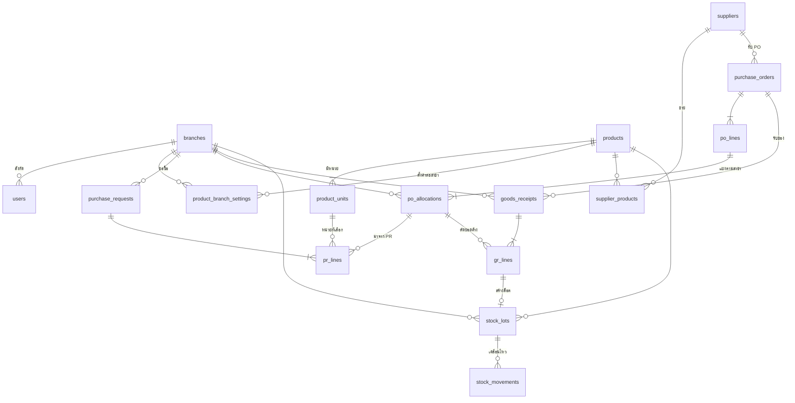

# Data Model

> PostgreSQL เก็บข้อมูลธุรกรรม · MongoDB เก็บ audit log และ notification (ADR-0001)
> ชื่อตารางและคอลัมน์เป็น `snake_case` · id เป็น `uuid` (Guid v7 สร้างฝั่ง .NET เรียงตามเวลาได้)
> เงิน `numeric(12,2)` · จำนวนเป็น `integer` (ADR-0005)

## ภาพรวม



## ข้อมูลหลัก (master)

### `branches`
| คอลัมน์ | ชนิด | หมายเหตุ |
| --- | --- | --- |
| id | uuid PK | |
| code | varchar(10) UNIQUE | `B1`, `B2`, `B3` |
| name | varchar(100) | สาขา 1 ฯลฯ |

### `users`
| คอลัมน์ | ชนิด | หมายเหตุ |
| --- | --- | --- |
| id | uuid PK | |
| display_name | varchar(100) | นภา ใจดี |
| role | varchar(20) | `Staff` · `BranchManager` · `Purchasing` · `Owner` · `Admin` (rbac.md) |
| branch_id | uuid FK null | ต้องมีค่าเมื่อ role = Staff / BranchManager · CHECK constraint |
| is_demo | boolean | persona สำหรับหน้า demo login |

### `products`
| คอลัมน์ | ชนิด | หมายเหตุ |
| --- | --- | --- |
| id | uuid PK | |
| sku | varchar(30) UNIQUE | |
| name | varchar(200) | |
| category | varchar(50) | นม, ขนมปัง, เครื่องดื่ม … |
| has_expiry | boolean | true = ต้องกรอกวันหมดอายุตอนรับของ (US-001 AC 5) |
| unit_cost | numeric(12,4) | ต้นทุนต่อหน่วยฐาน ใช้คำนวณมูลค่าใกล้หมดอายุ |

### `product_units` (US-004)
| คอลัมน์ | ชนิด | หมายเหตุ |
| --- | --- | --- |
| id | uuid PK | |
| product_id | uuid FK | |
| name | varchar(30) | ขวด, แพ็ค, ลัง |
| factor | integer > 0 | จำนวนหน่วยฐานต่อ 1 หน่วย · หน่วยฐาน = 1 |
| is_base | boolean | |
| is_purchase_unit | boolean | |

- UNIQUE (product_id, name)
- UNIQUE partial index: 1 หน่วยฐานต่อสินค้า `WHERE is_base` และ 1 หน่วยซื้อต่อสินค้า `WHERE is_purchase_unit`
- แก้หน่วยหรือ factor → เขียน audit log (US-004 AC 9) · PR เก่าไม่เปลี่ยนเพราะเก็บ `base_qty` ไว้แล้ว (AC 7)

### `product_branch_settings` (US-006, Q-SA-03)
| คอลัมน์ | ชนิด | หมายเหตุ |
| --- | --- | --- |
| product_id, branch_id | PK คู่ | |
| reorder_point | integer null | หน่วยฐาน · null = ไม่แนะนำ (US-006 AC 7) |
| max_stock | integer null | หน่วยฐาน |

### `suppliers`
| คอลัมน์ | ชนิด | หมายเหตุ |
| --- | --- | --- |
| id | uuid PK | |
| name | varchar(200) | บจก. สยามฟาร์มเฟรช |
| min_order_amount | numeric(12,2) null | ยอดขั้นต่ำก่อน VAT (US-005 AC 7) |
| contact_note | varchar(300) null | เช่น LINE ของผู้ขาย (ไว้แสดงในหน้าส่ง PDF) |

### `supplier_products` (US-005)
| คอลัมน์ | ชนิด | หมายเหตุ |
| --- | --- | --- |
| supplier_id, product_id | PK คู่ | |
| unit_price | numeric(12,2) | ราคาต่อ **หน่วยซื้อ** ก่อน VAT |
| is_primary | boolean | UNIQUE partial index: 1 ผู้ขายหลักต่อสินค้า (AC 6) |

## เอกสาร

### `purchase_requests` (PR)
| คอลัมน์ | ชนิด | หมายเหตุ |
| --- | --- | --- |
| id | uuid PK | |
| number | varchar(20) UNIQUE | `PR-2026-0231` (sequence ต่อปี) |
| branch_id | uuid FK | |
| status | varchar(20) | state-machines.md |
| requested_by | uuid FK users | |
| submitted_at, approved_at | timestamptz null | |
| approved_by | uuid FK null | |
| created_at, updated_at | timestamptz | |

### `pr_lines`
| คอลัมน์ | ชนิด | หมายเหตุ |
| --- | --- | --- |
| id | uuid PK | |
| pr_id | uuid FK | |
| product_id | uuid FK | |
| unit_id | uuid FK product_units | หน่วยที่ผู้ขอเลือก (AC 1) |
| qty | integer > 0 | ในหน่วยที่เลือก |
| base_qty | integer > 0 | qty × factor ณ ตอนสร้าง (AC 2, 7) |
| po_allocation_id | uuid FK null | null = รอรวม · มีค่า = รวมเข้า PO แล้ว (US-005 AC 4, 10) |

PR เป็น `Converted` เมื่อทุกบรรทัดมี `po_allocation_id` · ลบบรรทัดจากร่าง PO → ตั้งกลับเป็น null (US-005 AC 10)

### `purchase_orders` (PO)
| คอลัมน์ | ชนิด | หมายเหตุ |
| --- | --- | --- |
| id | uuid PK | |
| number | varchar(20) UNIQUE | `PO-2026-0835` |
| supplier_id | uuid FK | 1 ผู้ขายต่อ PO (BR-05) |
| status | varchar(20) | state-machines.md |
| subtotal | numeric(12,2) | Σ บรรทัด ก่อน VAT · คำนวณใหม่ทุกครั้งที่แก้บรรทัด |
| vat_rate | numeric(5,4) | 0.0700 ณ ตอนสร้าง |
| vat_amount, total | numeric(12,2) | ปัดครึ่งขึ้น 2 ตำแหน่ง |
| required_approver_role | varchar(20) null | ตั้งตอน submit: `BranchManager` หรือ `Owner` (US-002, Q-SA-01) |
| approval_branch_id | uuid FK null | สาขาที่ผู้จัดการอนุมัติได้ (มีค่าเมื่อ PO ส่งสาขาเดียว) |
| submitted_at, approved_at, sent_at, closed_at | timestamptz null | `sent_at` = จุดเริ่มนับ 7 วัน (US-001 AC 8) |
| approved_by, sent_by | uuid FK null | |
| sent_channel | varchar(20) null | `Line` · `Phone` · `Other` (US-007 AC 4) |
| close_reason | varchar(200) null | "ยกเลิกอัตโนมัติ: ค้างส่งเกิน 7 วัน" ฯลฯ |
| xmin | system | optimistic concurrency |

### `po_lines`
| คอลัมน์ | ชนิด | หมายเหตุ |
| --- | --- | --- |
| id | uuid PK | |
| po_id | uuid FK | |
| product_id | uuid FK | |
| unit_id | uuid FK | หน่วยซื้อ |
| qty_ordered | integer | ผลรวมของ allocations · หน่วยซื้อ |
| unit_price | numeric(12,2) | แก้ได้ตอน Draft (US-005 AC 8) |
| line_total | numeric(12,2) | qty × price |
| added_by_suggestion | boolean | ป้าย "เพิ่งเพิ่ม" (US-005 AC 11) |

### `po_allocations` — ยอดของแต่ละสาขาในบรรทัด PO
| คอลัมน์ | ชนิด | หมายเหตุ |
| --- | --- | --- |
| id | uuid PK | |
| po_line_id | uuid FK | |
| branch_id | uuid FK | UNIQUE (po_line_id, branch_id) |
| qty_ordered | integer | หน่วยซื้อ |
| qty_received | integer default 0 | อัปเดตใน transaction เดียวกับใบรับของ |
| qty_cancelled | integer default 0 | จาก job 7 วัน หรือปิดมือ |

**ยอดค้างส่ง** = `qty_ordered − qty_received − qty_cancelled` (glossary) · CHECK `qty_received + qty_cancelled <= qty_ordered`

เหตุผลที่แยกตารางนี้: ผู้ขายส่งของแยกถึงแต่ละสาขา (US-005 คำตอบ clarify) พนักงานสาขา 2 จึงรับได้เฉพาะยอดของสาขา 2 และยอดค้างต้องนับแยกสาขา

### `goods_receipts` (GRN)
| คอลัมน์ | ชนิด | หมายเหตุ |
| --- | --- | --- |
| id | uuid PK | |
| number | varchar(20) UNIQUE | `GRN-2026-0311` |
| po_id | uuid FK | |
| branch_id | uuid FK | |
| received_by | uuid FK | |
| received_at | timestamptz | |
| idempotency_key | varchar(64) UNIQUE | US-001 AC 9 |

### `gr_lines`
| คอลัมน์ | ชนิด | หมายเหตุ |
| --- | --- | --- |
| id | uuid PK | |
| gr_id | uuid FK | |
| po_allocation_id | uuid FK | |
| qty | integer > 0 | หน่วยซื้อ · ≤ ยอดค้าง (AC 4) |
| base_qty | integer | qty × factor |
| lot_no | varchar(40) | |
| expiry_date | date null | บังคับเมื่อ `products.has_expiry` (AC 5) |
| stock_lot_id | uuid FK | |

## สต็อก

### `stock_lots`
| คอลัมน์ | ชนิด | หมายเหตุ |
| --- | --- | --- |
| id | uuid PK | |
| branch_id, product_id | uuid FK | |
| lot_no | varchar(40) | |
| expiry_date | date null | |
| qty_on_hand | integer ≥ 0 | หน่วยฐาน |
| unit_cost | numeric(12,4) | ต้นทุนต่อหน่วยฐาน ณ ตอนรับ |
| received_at | timestamptz | |
| xmin | system | concurrency |

- UNIQUE (branch_id, product_id, lot_no, expiry_date) · รับล็อตเดิมซ้ำ → บวกเข้าแถวเดิม
- INDEX (branch_id, expiry_date) WHERE qty_on_hand > 0 (US-003 Task)

### `stock_movements` — สมุดบัญชีสต็อก เพิ่มอย่างเดียว ห้ามแก้ห้ามลบ
| คอลัมน์ | ชนิด | หมายเหตุ |
| --- | --- | --- |
| id | uuid PK | |
| stock_lot_id | uuid FK | |
| qty_change | integer | + รับ, − ปรับลด |
| type | varchar(20) | `Receive` · `AdjustWaste` · `AdjustCount` |
| reason | varchar(200) null | บังคับเมื่อปรับสต็อก (US-003 AC 10) |
| ref_type, ref_id | varchar(20), uuid | `GoodsReceipt` / `StockAdjustment` |
| created_by | uuid FK | |
| created_at | timestamptz | |

`stock_lots.qty_on_hand` ต้องเท่ากับผลรวม `qty_change` ของล็อตนั้นเสมอ (มี integration test ตรวจ)

## ตั้งค่า

### `approval_limits` (US-002)
| role | max_amount |
| --- | --- |
| BranchManager | 5000.00 |
| Owner | null (ไม่จำกัด) |

### `app_settings`
| key | ค่าเริ่มต้น | ใช้ใน |
| --- | --- | --- |
| `ExpiryAlertDays` | 3 | US-003 AC 2, 8 |
| `OutstandingCancelDays` | 7 | US-001 AC 8 |
| `VatRate` | 0.07 | PO |
| `StoreHeader` | ชื่อร้าน, ที่อยู่, เลขผู้เสียภาษี | US-007 PDF |

## MongoDB

### `audit_logs`
```json
{
  "_id": "ObjectId",
  "at": "2026-11-17T08:15:00Z",
  "actor": { "userId": "…", "name": "นภา ใจดี", "role": "BranchManager" },
  "action": "PurchaseOrder.Approved",
  "entity": { "type": "PurchaseOrder", "id": "…", "number": "PO-2026-0835" },
  "before": { "status": "PendingApproval" },
  "after":  { "status": "Approved" },
  "traceId": "00-…"
}
```
index: `{ "entity.id": 1, "at": -1 }`, `{ "action": 1, "at": -1 }`

action ที่ต้องเขียน: อนุมัติ/ตีกลับ PO (US-002 AC 1) · แก้หน่วย (US-004 AC 9) · ทำเครื่องหมายส่งแล้ว (US-007 AC 4) · ปรับสต็อก (US-003 AC 10) · ปิด PO และยกเลิกยอดค้าง (US-001 AC 8)

### `notifications`
```json
{
  "_id": "ObjectId",
  "userId": "…",
  "type": "ExpiryDigest",
  "title": "มีสินค้าใกล้หมดอายุ 5 รายการ มูลค่า ฿740",
  "link": "/manager",
  "dedupeKey": "ExpiryDigest:B2:2026-11-17",
  "createdAt": "2026-11-17T00:00:00Z",
  "readAt": null
}
```
- UNIQUE index `dedupeKey` กันส่งซ้ำวันเดียวกัน (US-003 AC 6)
- TTL index `createdAt` 90 วัน
- type: `ExpiryDigest` (US-003) · `PoAwaitingOwner` (US-002 AC 6) · `OutstandingCancelled` (US-001 AC 8)

## ทำไมไม่เก็บ audit ใน PostgreSQL ด้วย

ดู ADR-0001 สรุปคือ audit log เขียนเพิ่มอย่างเดียว รูปร่าง before/after ต่างกันตาม action และไม่ต้อง join กับธุรกรรม ส่วนข้อมูลที่ต้องถูกต้องร่วมกันใน transaction (PO, ใบรับของ, สต็อก) อยู่ใน PostgreSQL ทั้งหมด

ถ้าเขียน Mongo ไม่สำเร็จหลัง commit PostgreSQL แล้ว: log error แล้วไปต่อ ไม่ rollback ธุรกรรม (ยอมรับได้สำหรับ MVP · ทางที่ดีกว่าคือ outbox pattern → backlog)

## ประวัติการแก้ไข

| วันที่ | การเปลี่ยนแปลง |
| --- | --- |
| 17 พ.ย. 2026 | ฉบับแรก |
