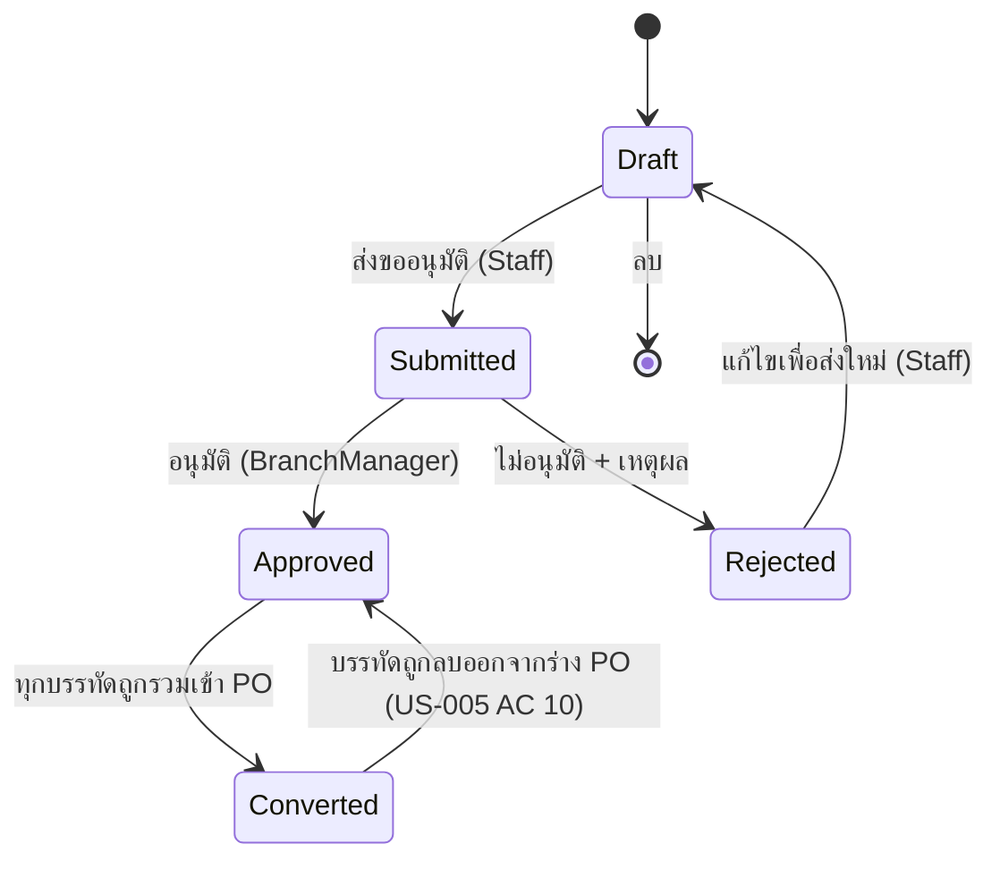
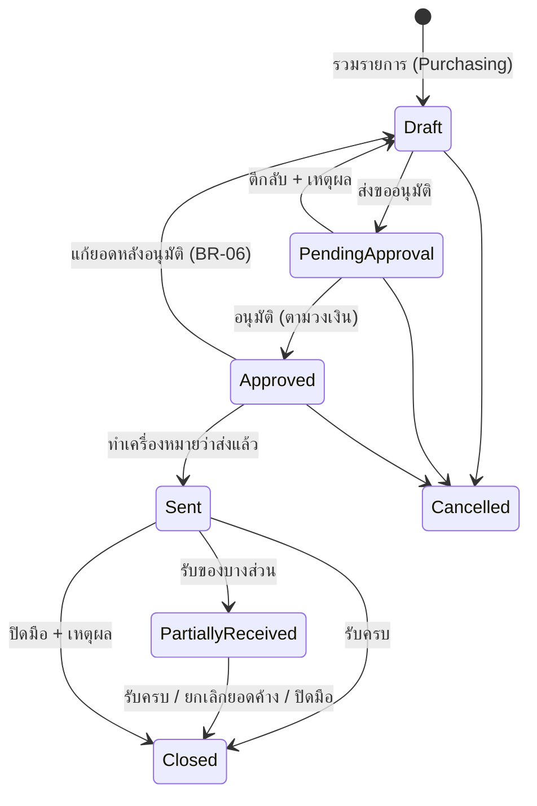

# State Machines

> กฎการเปลี่ยนสถานะอยู่ใน Domain (`PurchaseOrder.Approve()` ฯลฯ) ไม่อยู่ใน controller
> เปลี่ยนสถานะไม่ได้ตามตาราง → API ตอบ **409 Conflict** (`type: invalid-state-transition`)

## Purchase Request (PR)



| จาก | ไป | ใครทำ | เงื่อนไข | อ้างอิง |
| --- | --- | --- | --- | --- |
| Draft | Submitted | Staff สาขานั้น | มีอย่างน้อย 1 บรรทัด · จำนวนถูกต้อง | US-004 AC 5 · US-006 AC 6 |
| Submitted | Approved | BranchManager สาขานั้น | | Q-SA-02 |
| Submitted | Rejected | BranchManager สาขานั้น | ต้องมีเหตุผล | Q-SA-02 |
| Rejected | Draft | Staff | | |
| Approved | Converted | ระบบ | ทุกบรรทัดมี `po_allocation_id` | US-005 AC 4 |
| Converted | Approved | ระบบ | บรรทัดถูกลบจากร่าง PO | US-005 AC 10 |

## Purchase Order (PO)



| จาก | ไป | ใครทำ | เงื่อนไข / ผลข้างเคียง | อ้างอิง |
| --- | --- | --- | --- | --- |
| Draft | PendingApproval | Purchasing, Owner | ตั้ง `required_approver_role` และ `approval_branch_id` (ดูด้านล่าง) · ถ้าเป็น Owner สร้าง notification `PoAwaitingOwner` | US-002 AC 3, 6 |
| PendingApproval | Approved | ผู้ที่ผ่านกฎวงเงิน | บันทึก `approved_by/at` + audit log | US-002 AC 1, 2, 4 |
| PendingApproval | Draft | ผู้ที่ผ่านกฎวงเงิน | ตีกลับ ต้องมีเหตุผล + audit log | ดีไซน์ W02-A |
| Approved | Draft | Purchasing, Owner | แก้จำนวน/ราคา/บรรทัด → ล้างข้อมูลอนุมัติ | US-002 AC 5 (BR-06) |
| Approved | Sent | Purchasing, Owner | บันทึก `sent_at/by/channel` + audit log | US-007 AC 4 |
| Sent | PartiallyReceived | Staff, BranchManager ของสาขาที่มียอด | มีบาง allocation ยังค้าง | US-001 AC 2 |
| Sent / PartiallyReceived | Closed | ระบบ | ทุก allocation ค้าง = 0 | US-001 AC 1, 3 |
| PartiallyReceived | Closed | ระบบ (job) | `now − sent_at > OutstandingCancelDays` → ใส่ `qty_cancelled` = ยอดค้าง, เหตุผล "ยกเลิกอัตโนมัติ: ค้างส่งเกิน 7 วัน", แจ้ง Purchasing | US-001 AC 8 |
| Sent / PartiallyReceived | Closed | Purchasing | ปิดมือ ต้องมีเหตุผล | US-001 clarify |
| Draft / PendingApproval / Approved | Cancelled | Purchasing, Owner | บรรทัด PR ที่ผูกอยู่กลับเป็นรอรวม | |

### กฎเลือกผู้อนุมัติ (ตอน Draft → PendingApproval)

```
ถ้า subtotal ≤ approval_limits[BranchManager] และ PO ส่งถึงสาขาเดียว
    required_approver_role = BranchManager
    approval_branch_id     = สาขานั้น
ไม่อย่างนั้น
    required_approver_role = Owner
```

**ใครกดอนุมัติได้:** Owner อนุมัติได้ทุกใบ · BranchManager อนุมัติได้เมื่อ `required_approver_role = BranchManager` และ `approval_branch_id` = สาขาตัวเอง · กรณีอื่นได้ 403 (US-002 AC 3)

ขอบเขต: `subtotal ≤ 5000.00` อนุมัติได้ (5,000 พอดีผ่าน · 5,000.01 ไม่ผ่าน) ต้องมี unit test ทั้งสองค่า (US-002 AC 2)

## สถานะที่หน้าจอแสดง (ไม่ได้เก็บใน DB)

| หน้าจอ | สถานะ | คำนวณจาก |
| --- | --- | --- |
| M02-A รายการ PO ของสาขา | "รอรับ" / "รับบางส่วน" | allocation ของสาขานั้น ไม่ใช่สถานะ PO ทั้งใบ |
| W02-A ตัวนับถอยหลัง | "อีก 20 ชม. 14 นาที" | `sent_at + OutstandingCancelDays − now` |
| W02-B | "รอเจ้าของอนุมัติ" | `required_approver_role = Owner` |

## ประวัติการแก้ไข

| วันที่ | การเปลี่ยนแปลง |
| --- | --- |
| 17 พ.ย. 2026 | ฉบับแรก |
